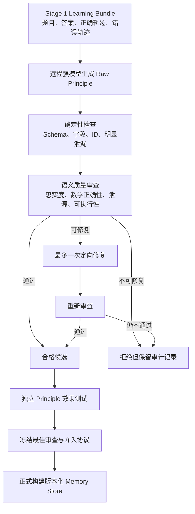
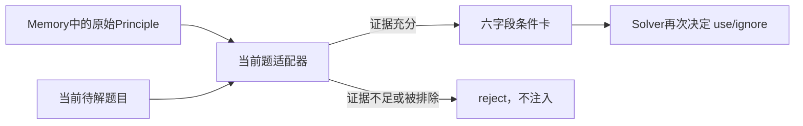
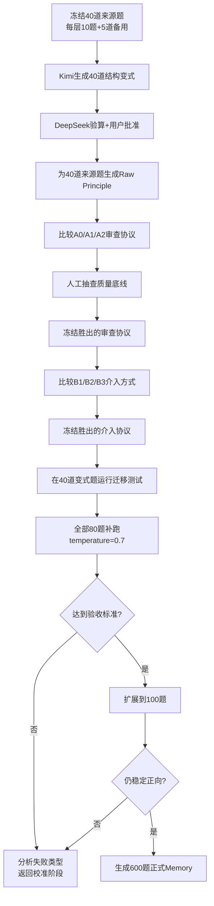

# Stage 2 Principle 生成、审查与有效性校准流程

> 状态：实验设计确认稿  
> 范围：Stage 2 与其独立测试流程  
> 当前目标：先确定什么样的 Principle 能稳定帮助 Solver，再进行大规模 Memory 构建  
> 模型调用：全部使用远程 API，不依赖本地模型部署

## 1. 这一步要解决什么问题

Stage 1 已经保存 Agent 对同一道题的正确与错误推理轨迹。Stage 2 的任务不是简单地把轨迹压缩成一句话，而是把轨迹差异转化为可检索、可拒绝、可执行、可验证的经验，也就是 Principle。

正式的 Stage 2 最终负责：

1. 从 Stage 1 的正确/错误轨迹中识别关键推理差异；
2. 生成一个或多个候选 Principle；
3. 排除不忠实、数学错误、答案泄漏和不可执行的候选；
4. 对可修复问题最多进行一次定向修复；
5. 将通过审查的 Principle 归类、版本化并写入 Memory Store。

但是，在批量生成 Memory 之前必须先解决一个前置问题：

> 什么样的 Principle 内容、审查方式和介入位置，能够真正改善弱模型的推理，而不是误导它？

因此，当前工作分成两个边界清楚的部分：

| 部分 | 负责什么 | 不负责什么 |
|---|---|---|
| 正式 Stage 2 | 生成、质量审查、修复、归类、版本化存储 | 不逐条证明准确率提升 |
| 独立测试流程 | 比较审查协议、介入内容和介入时机，分析无效或有害原因 | 不把测试结果直接写入正式 Memory |

只有独立测试确定了最佳协议，才冻结 Stage 2 并开始 100/600 题的大规模生成。

## 2. 整体路线



重要边界：

- 质量审查回答“这条经验是否可信、正确、无泄漏且可执行”；
- 效果测试回答“这条经验是否真的帮助了 Solver”；
- 两者不能合并成一个模糊的 `pass/fail` 判断。

## 3. 从轨迹生成 Principle

### 3.1 输入

每道题输入一个 Stage 1 Learning Bundle，至少包含：

- 当前题目；
- 标准答案；
- 多条正确 rollout；
- 多条错误 rollout；
- rollout ID、seed 和完整推理轨迹；
- 正确率分层信息。

熵值和选择排名可以保存在 Bundle 中，但默认不进入 Principle 生成 Prompt，避免生成模型受到“高熵/低熵”标签暗示。

### 3.2 生成逻辑

远程强模型按以下顺序分析：

1. 总结多条正确轨迹的共同有效做法；
2. 找到错误轨迹中的首个关键错误，而不是只描述最终答案错误；
3. 识别正确与错误推理开始产生结果差异的位置；
4. 将相似根因合并为同一失败类型；
5. 判断差异是源题特例，还是能够迁移到一类问题；
6. 只为有轨迹证据支持、具有一定可迁移性的根因生成候选 Principle；
7. 无法提取可靠经验时，明确保存为 `no_reliable_principle`，不能强制生成。

一道题可以产生 1–3 条独立 Principle，但每条必须对应一个清晰的失败根因，不能只是同一句建议的不同措辞。

### 3.3 Principle 的核心内容

```json
{
  "introspection": "错误推理为什么失败",
  "trigger_condition": "出现什么可观察结构时考虑该经验",
  "required_evidence": [
    "采用经验前必须在当前题确认的事实"
  ],
  "exclusion_condition": "出现什么情况时不要使用",
  "failure_mode": "该经验主要避免什么推理错误",
  "action_guidance": "建议式、可执行的求解步骤",
  "verification_step": "执行后如何检查结果",
  "generalization_level": "instance | family | universal",
  "scope": "经验适用范围"
}
```

生成要求：

- 使用建议语气，而不是把经验写成必须服从的定理；
- trigger、证据和排除条件必须能从新题题面判断；
- action 应包含足够的前因后果和操作细节；
- verification 必须能够发现该经验在当前题上是否用错；
- 不复制源题答案、专属数字、人物、对象或只对源题成立的结论。

## 4. Quality Audit 的目的与边界

审查只负责排除四类问题：

1. **轨迹不忠实**：Principle 声称的错误原因或正确方法无法从 Stage 1 轨迹得到支持；
2. **数学错误**：Principle 中的数学事实、条件或操作本身不成立；
3. **答案或实例泄漏**：包含源题答案、专属数字或只能记忆源题的细节；
4. **不可执行**：建议过于空泛、条件无法判断、操作无法执行或结果无法验证。

审查不负责预测：

- Llama 是否一定会采纳；
- Principle 是否一定提升准确率；
- Principle 在所有相似题上是否都有效；
- retrieval score 是否足够高。

### 4.1 第一层：确定性检查

由代码完成，不调用模型：

- JSON/Schema 是否完整；
- `required_evidence` 是否为 `list[str]`；
- 引用的 rollout ID 是否存在；
- 是否出现明确源答案或源题专属信息；
- trigger 是否错误地写成只有解完题后才能知道的结论。

格式失败必须单独记录，不能被统计成 Principle 内容质量失败。

### 4.2 第二层：语义内容审查

由远程强模型完成：

- 错误根因是否忠实于错误轨迹；
- 正确做法是否忠实于正确轨迹；
- 数学陈述是否成立；
- trigger、required evidence、exclusion 是否可判断；
- action 是否可执行；
- verification 是否真的能够检验该方法；
- 声称的泛化范围是否超过轨迹证据。

### 4.3 为什么审查和 JSON 格式化可以分开

此前的失败表现是：模型在 4096 tokens 内完成了大量 Thinking，却没有剩余空间输出最终 JSON。把上限提高到 8192 能缓解，但不能保证模型不会继续把全部预算用于 Thinking。

更稳定的协议是：

```text
Critic（Thinking）
  → 完成真实内容判断，输出逐项文字结论
Formatter（只格式化）
  → 不重新审查，不改变结论，只转换为严格JSON
```

Formatter 不是第二个审查员。它只解决输出协议问题。

## 5. 条件卡是什么

原始 Principle 是 Memory 中长期保存的通用经验；条件卡是 Principle 针对“当前待解题目”的一次性改写结果。



### 5.1 六字段条件卡

```json
{
  "when_to_consider": "当前题出现什么结构时考虑经验",
  "evidence_found": [
    {
      "requirement": "Principle要求确认的条件",
      "problem_fact": "当前题中支持该条件的事实"
    }
  ],
  "do_not_use_if": "当前题出现什么情况时拒绝经验",
  "failure_to_avoid": "需要避免的推理错误",
  "suggested_action": "针对当前题改写的建议步骤",
  "verification": "当前题上应该执行的检查"
}
```

各字段作用：

| 字段 | 作用 |
|---|---|
| `when_to_consider` | 用当前题可观察结构说明何时考虑经验 |
| `evidence_found` | 把 Principle 要求与当前题事实逐条对应 |
| `do_not_use_if` | 明确拒绝条件，减少过度服从 |
| `failure_to_avoid` | 提醒 Solver 防止哪类错误 |
| `suggested_action` | 给出建议式、可执行的操作 |
| `verification` | 检查经验是否使用正确以及结果是否成立 |

### 5.2 条件卡生成约束

条件卡生成模型只读取：

- 当前题；
- Principle 的 trigger；
- required evidence；
- exclusion；
- failure mode；
- action；
- verification。

不得读取或输出：

- 来源题和来源答案；
- 来源题正确/错误轨迹；
- Memory ID；
- retrieval score；
- Audit 结论或置信度；
- “该经验可靠”或“该经验一定适用”等路由结论。

条件卡生成器不得解答当前题。关键条件无法从题面确认时，必须返回 `reject`。即使它返回 `use`，Solver 仍然可以选择 `ignore`。

条件卡是介入测试和未来 Stage 3 的组件，不是正式 Stage 2 中永久保存的 Memory 内容。

## 6. 测试阶段比较哪些方案

不能直接运行“3种审查 × 3种介入”的全部九种组合。那会同时改变多个变量，难以判断差异来自哪里。因此采用两轮逐项筛选。

### 6.1 第一轮：选择审查协议

这一轮固定使用同一种“直接短卡”介入，只改变审查方法。

| 编号 | 路径 | 作用 |
|---|---|---|
| A0 | Raw Principle，不做语义审查 | 诊断对照，不能成为最终正式方案 |
| A1 | 单次 Thinking 审查，最多8192 tokens，直接输出 JSON，必要时修复一次 | 检查单次长输出是否足够稳定 |
| A2 | Critic Thinking 审查 + Formatter 严格格式化，必要时修复一次 | 检查判断与格式分离是否更稳定有效 |

A0 的意义不是取消审查，而是回答：

> A1/A2 的审查与修复是否真的减少有害 Principle，同时没有错杀有帮助的 Principle？

选择审查协议时必须先满足质量底线，再比较下游效果。即使错误或泄漏的 Principle 让来源题答对，也不能被认为是有效经验。

### 6.2 第二轮：选择 Principle 介入方式

冻结第一轮胜出的审查协议，只改变 Principle 进入 Solver 的位置和内容。

| 编号 | 路径 | 回答的问题 |
|---|---|---|
| B1 | 直接短卡：lesson + action + verification | 最少信息能否直接纠正推理？ |
| B2 | 推理前条件卡：六字段条件卡 → Solver use/ignore → 求解 | 条件约束能否减少错误使用？ |
| B3 | Solver先给初步计划 → 条件卡校准 → Solver use/ignore → 完整求解 | 延后介入能否减少过早锚定？ |

Baseline 始终为：

```text
当前题 → 相同Solver协议 → Finalizer
```

Baseline 不输入任何 Principle，也不根据答错进行重试。

## 7. 40道来源题与40道结构变式题

当前实验共有80道题，每个Level都保持相同规模：

| 数据用途 | Level 1 | Level 2 | Level 3 | Level 4 | 合计 |
|---|---:|---:|---:|---:|---:|
| Stage 1来源题 | 10 | 10 | 10 | 10 | 40 |
| Kimi结构变式题 | 10 | 10 | 10 | 10 | 40 |
| 总计 | 20 | 20 | 20 | 20 | 80 |

来源题用于选择审查协议和介入方式。每道来源题由Kimi生成一道只改变表面、数字和对象的结构变式题，随后由DeepSeek独立验算。Kimi和DeepSeek在这一步都看不到Principle或Stage 1轨迹。

40道变式题必须全部经过用户人工批准，才能运行迁移测试。变式题只继承配对来源题的Level标签用于分组分析；在重新完成Stage 1 pass@10前，不声称变式题本身属于该Level。

这40+40题可以筛掉明显有害路径、选择是否进入大样本实验，但不能代替论文最终完整测试集的泛化结论。

## 8. 重复次数与配对指标

### 8.1 审查稳定性

校准阶段，每条候选 Principle 独立审查3次，用于测量同一协议是否稳定：

- 3次完全一致：稳定；
- 2比1：记录少数分歧及原因；
- 三次结论分散：协议或审查定义不稳定，不能直接全量使用。

正式流程冻结后不一定永久使用三次审查。可改为一次主审，只有不确定或字段冲突时再复审。

### 8.2 Solver 效果重复

每个“题目—Principle—实验臂”固定运行10次独立推理，seed 为：

```text
42, 43, 44, 45, 46, 47, 48, 49, 50, 51
```

Baseline 与 Guided 必须使用完全相同的题目、seed、温度、Solver Prompt 和答案提取器；唯一差别是是否介入 Principle。

主要指标：

```text
baseline_correct@10
guided_correct@10
delta_correct = guided_correct@10 - baseline_correct@10
```

配对结果：

| 结果 | 定义 |
|---|---|
| gain | Baseline错误，Guided正确 |
| loss | Baseline正确，Guided错误 |
| both_correct | 两者都正确 |
| both_wrong | 两者都错误 |

描述性标签：

```text
delta_correct >= 2  → 明显正向
delta_correct <= -2 → 明显有害
-1 / 0 / 1         → 暂无定论
```

“有害”描述的是某条 Principle 在某道题和某种介入方式下造成的配对退化，不是说题目本身有害。

### 8.3 为什么不把400个rollout当作400道独立题

同一道题的10个seed共享题目和 Principle，彼此不是完全独立样本。统计时必须以题目为聚类单位：

- 报告每题 `delta_correct`；
- 先在题目内汇总，再跨题比较；
- paired bootstrap 按题目重采样；
- 不用重复seed虚增统计显著性。

## 9. 如何选择最优路径

选择顺序固定，不能只按准确率排序。

### 9.1 第一优先级：质量底线

修复后必须满足：

```text
数学错误 = 0
答案/实例泄漏 = 0
轨迹不忠实 = 0
不可执行建议 = 0
```

小样本阶段需要人工抽查。自动审查结果不能被直接当成无误的真值。

### 9.2 第二优先级：减少副作用

比较：

- loss 数量；
- 明显有害的 Principle—题目对比例；
- 原本答对却因经验变错的比例；
- Solver 因 Principle 产生错误锚定的比例。

### 9.3 第三优先级：提升效果

比较：

- 平均 `delta_correct`；
- gain 是否多于 loss；
- 至少多少道题获得正收益；
- 各 Level 的方向是否一致；
- 推理路径是否真的纠正，而不是依赖答案暗示。

### 9.4 第四优先级：稳定性和成本

只有前面接近时才比较：

- 审查三次的一致率；
- JSON 完成率；
- 平均调用次数；
- token 与时间成本。

40道来源题和40道变式题上，胜出方案至少应满足：

- 平均 `delta_correct > 0`；
- gain 多于 loss；
- 没有质量底线违规；
- 至少三个 Level 的效果方向不为负；
- 不由少数题的极端提升掩盖大量小幅退化。

如果前两名平均每题 `correct@10` 差距小于约0.5，40题通常不足以可靠区分，应扩展到60–100题，而不是直接宣称某条路径最优。

## 10. 推荐执行顺序



执行时的实际顺序：

1. 冻结40道来源题、20道同Level备用题和输入hash；
2. Kimi为40题生成结构变式，DeepSeek独立验算；
3. 用户人工批准全部40道变式题；
4. DeepSeek为40道来源题生成Raw Principle；
5. 在全部40道来源题比较A0/A1/A2，冻结审查协议；
6. 在全部40道来源题比较B1/B2/B3，其中B3只与等成本plan-only比较；
7. 冻结介入协议，在40道变式题运行迁移测试；
8. 全部80题补跑temperature=0.7；
9. 达标后扩展到100题；
10. 100题仍稳定后再生成600题正式Candidate Bank和Memory Store。

## 11. 结果必须保存什么

建议输出目录：

```text
output/stage2/principle_test_80_v1/
├── manifests/
│   ├── source40.json
│   ├── reserve20.json
│   └── variant40.json
├── source_bundles/
├── variants/
├── raw_candidates/
├── audit_variants/
│   ├── raw_control/
│   ├── single_call_8192/
│   └── critic_formatter/
├── repaired_candidates/
├── intervention_variants/
│   ├── direct_short_card/
│   ├── pre_reasoning_condition_card/
│   └── post_plan_condition_card/
├── effect_evaluation/
├── failure_analysis/
└── comparison/
```

每次远程 API 调用保存：

- 服务商和 base URL（不得保存 API Key）；
- 精确 model ID 和调用时间；
- temperature、top_p、max_tokens、Thinking 设置；
- seed（如果服务端支持）；
- Prompt hash；
- 原始响应；
- reasoning content 与 final content；
- finish reason 和 token usage；
- JSON 解析阶段和错误原因。

每条候选保存：

- 原始 Principle；
- 三次审查的原始判断；
- 修复前后逐字段差异；
- 条件卡；
- Solver 实际看到的完整 Prompt；
- use/ignore 决策；
- 10个seed的完整输出和正确性；
- gain/loss/both_correct/both_wrong；
- 无效或有害原因分析。

## 12. 远程 API 的复现风险

远程服务可能在不改变公开名称的情况下更新模型。为了使实验可追踪：

- 固定并记录精确模型名；
- 保存调用日期和服务端返回的模型版本字段；
- 保存全部参数和 Prompt hash；
- 同一对照实验尽量在短时间窗口内完成；
- 不把不同日期、不同模型版本的结果静默合并；
- API Key 只从环境变量或被 `.gitignore` 忽略的本地配置读取。

## 13. 最终冻结后的 Stage 2

完成以上校准后，正式 Stage 2 才固定为：

```text
Stage 1 Learning Bundle
→ 轨迹差异与根因分析
→ Principle Generation
→ 确定性检查
→ 已选定的语义审查协议
→ 最多一次定向修复
→ 重新审查
→ add / covered / update / merge / reject
→ 版本化Memory Store
```

而正式 Stage 3 使用：

```text
当前题
→ SPD结构化召回
→ 当前题适配
→ 已冻结的条件卡介入方式
→ Solver use/ignore并求解
→ Finalizer
```

论文中的核心论证顺序应当是：

1. 先证明基础 Principle 质量和介入协议不会系统性伤害 Solver；
2. 再证明 Stage 1 能更有效地选择值得学习的能力边界样本；
3. 再证明 SPD 的结构化表示与召回比单向量任务描述更精确；
4. 最后证明这两个关口共同帮助 Agent 将 Learning Zone 中的问题逐轮转化为可稳定解决的问题。
